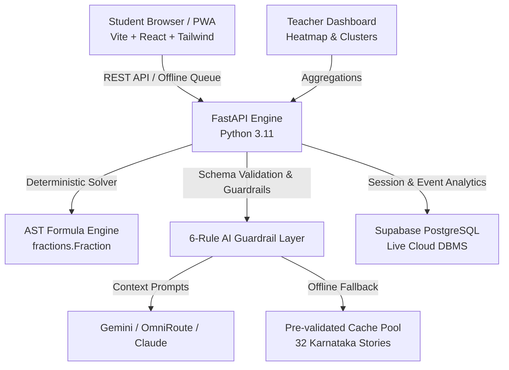

# StoryMath Pitch Deck & 3-Minute Demo Script

> **Team Edvance:** Stuthi Mathapati (Lead), MD Irfan Darvan, Jahnavi P, Rishab Dhruv  
> **Track:** EdTech / AI for Classroom Impact (Karnataka)  
> **Target Cohort:** Class 5–7 Students in Karnataka State & Government Schools  

---

## 1. The Core Problem (The Hidden Misconception Trap)

- **The Ground Reality in Karnataka (Verified Field Data):**
  - **19% Competency:** Only ~19% of Class 5 students in rural Karnataka government schools can successfully solve a basic division word problem (*ASER 2024*).
  - **53% Competency:** In Class 6, only 53% can apply fundamental arithmetic to solve daily life context problems (*PARAKH Rashtriya Sarvekshan 2024, NCERT*).
- **The Fatal Flaw of Traditional Word Problems:**
  - A student gets a problem wrong in a workbook. The teacher writes `✕` and marks it `0/2`.
  - **Why did the student fail?**
    1. Did they fail reading comprehension (language barrier / Kannada-English transfer)?
    2. Did they pick the wrong mathematical operation (`+` instead of `÷`)?
    3. Did they understand the concept but make a minor arithmetic calculation slip?
  - Traditional homework and test papers **never tell the teacher where the breakdown occurred**.
  - As a result, teachers repeat arithmetic drill sheets instead of fixing structural misconceptions.

---

## 2. Our Solution: "StoryMath: Same Maths, Different Story"

StoryMath decouples the **mathematical structure** from the **surface narrative**:
1. **Mathematical Invariant:** The numbers, constraints, and relationships are mathematically verified and invariant.
2. **Personalized Narrative:** The story adapts dynamically to the student's personal world and interests (Cricket, Bengaluru Metro, Dussehra/Channapatna toys, ISRO rockets, Village market).
3. **5-Step Scaffolding:** Breaks every word problem into 5 discrete diagnostic stages:
   - **Step 1: Facts Tapper** — Select what is *Given* vs. what is *Asked* (eliminates reading distraction).
   - **Step 2: Concrete Model** — Interactive visual model (Bar Model, Array Grid, Number Line, Ratio Table).
   - **Step 3: Operation Choice** — Explicitly select mathematical operation (`+`, `-`, `×`, `÷`) before writing numbers.
   - **Step 4: Calculation** — Carry out arithmetic calculation.
   - **Step 5: Sense Check** — Estimation sanity check ("Does ₹1,400 per cricket bat make sense?").
4. **Transfer Problem:** Immediately presents a second problem with the *exact same mathematical structure* in an entirely different story context to test true conceptual transfer vs surface memorization.

---

## 3. Strict Safeguards & Responsible AI

- **Deterministic Arithmetic:** The AI **never** computes numbers or answers. All values are generated via Python AST formulas and deterministic fractions (`fractions.Fraction`) to prevent LLM hallucinations.
- **6-Rule Automated Guardrails:**
  1. Strict number preservation (original values must appear verbatim).
  2. No accidental answer reveals in the story text.
  3. Culturally familiar Indian & Karnataka contexts (rupees, kilograms, local names).
  4. Age-appropriate vocabulary for Class 5–7 (CEFR A2 level).
  5. Content safety and educational tone.
  6. Deterministic 32-story offline cache fallback when offline or without API connectivity.
- **Privacy by Design:** Zero student PII stored. Only anonymous identifiers (`S-101`, `S-102`) and class codes (`CLASS-6A`).

---

## 4. Teacher Diagnostics Dashboard (Person D)

- **Structure-by-Step Misconception Heatmap:**
  - Maps 6 core structures (`equal_sharing`, `equal_groups`, `difference_comparison`, `unit_rate`, `fraction_of_a_quantity`, `perimeter_area`) against the 5 steps.
  - Highlights whether students in Class 6A are failing at **Operation Selection** vs **Calculation**.
- **Stuck Student Clusters:**
  - Automatically clusters students struggling with identical structural misconceptions.
  - Provides instant pedagogical remediation intervention strategies for the teacher's next class period.
- **Teacher Diagnosis Override:**
  - Enables teachers to adjust diagnostic flags if a student had a hardware or typo error.

---

## 5. Technical Architecture

---

## 6. Three-Minute Pitch Demo Script

| Time | Presenter | Visual / Action | Key Talk Track |
|---|---|---|---|
| **0:00 - 0:45** | Lead (Stuthi) | Slide 1 (ASER 2024 Data) | *"Why do 81% of Class 5 kids in Karnataka fail word problems? Not because they can't do 48 divided by 4, but because word problems conflate reading comprehension with structural math thinking. Let me show you StoryMath."* |
| **0:45 - 1:45** | Dev (Irfan) | Student Solve Flow (`/`) | *"Student S-101 loves ISRO rockets. The app delivers a problem about Chandrayaan payloads. Notice the 5-step breakdown: Facts -> Model -> Operation -> Calculation -> Sense Check. If the student picks multiplication instead of division, we catch it right here at Step 3 before they do any math. Then, the transfer test presents the same structure with Mysore Pak sweets."* |
| **1:45 - 2:30** | Dev (Jahnavi/Rishab) | Teacher Dashboard (`/teacher`) | *"Now look at what the teacher sees. Instead of a stack of graded papers, Class 6A's live heatmap shows equal_sharing has 7 failures clustered at the 'Operation' step, not Calculation! The teacher immediately knows tomorrow's lesson must focus on dividing sets, not long division arithmetic."* |
| **2:30 - 3:00** | Lead (Stuthi) | Slide 4 & Conclusion | *"StoryMath requires zero student PII, features guaranteed deterministic math with zero hallucination, runs 100% offline via local cache, and transforms word problem anxiety into conceptual mastery. Thank you!"* |

---

## 7. Pilot Protocol & Feasibility

- **Pilot Size:** 10–15 students in a Bengaluru government / state-board school (Class 6).
- **Duration:** 3 sessions over 1 week (Baseline diagnostic -> StoryMath intervention -> Transfer post-test).
- **Core Metrics Tracked:**
  - Transfer gain: Conceptual accuracy on varied narratives with identical structure.
  - Step-failure localization: Reduction in repeated operation errors.
  - Story validity: 100% mathematical constraint compliance.
  - Hint reliance decay: Number of hints required per problem attempt over time.
- **Scientific Integrity:** The team acknowledges this preliminary pilot has no randomized control group; results will report observed performance shifts, not causal claims.
